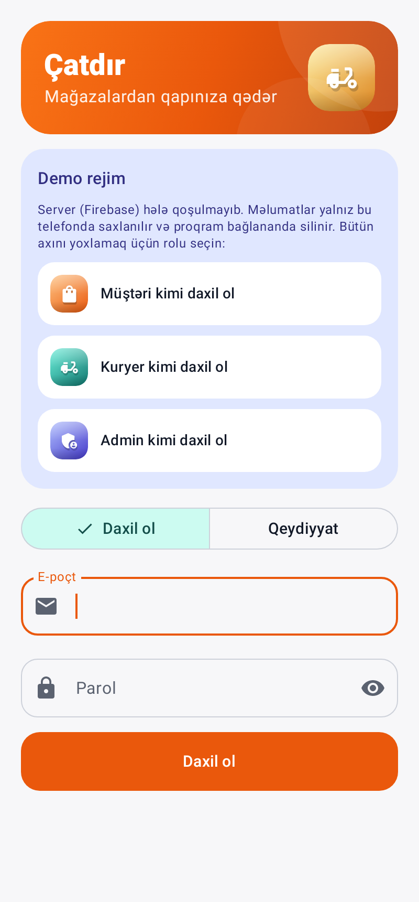
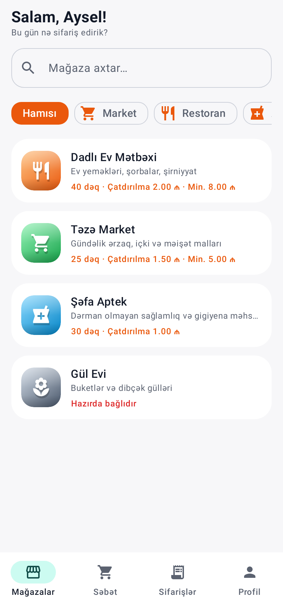
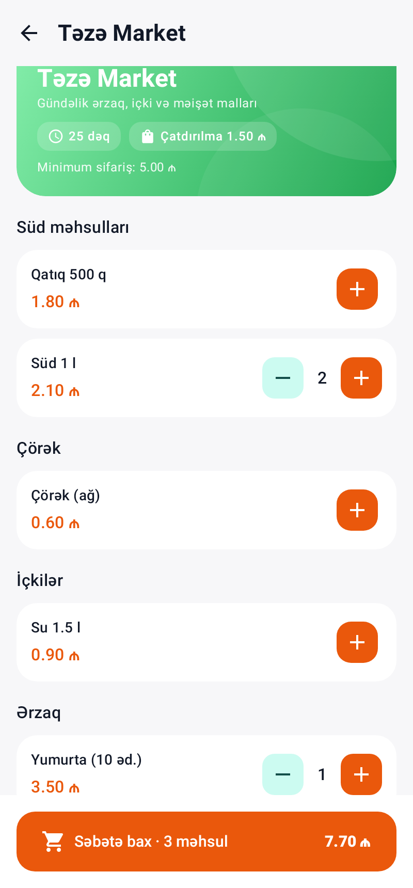
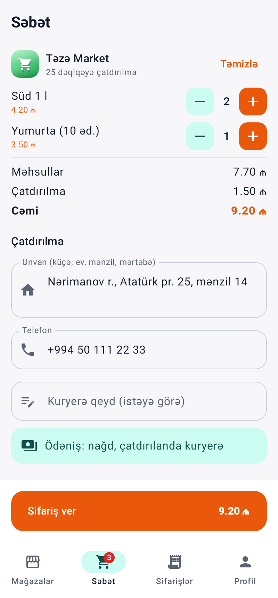
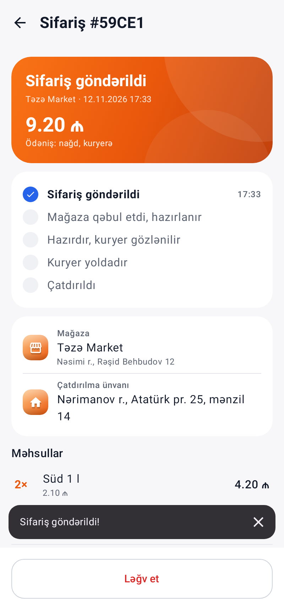
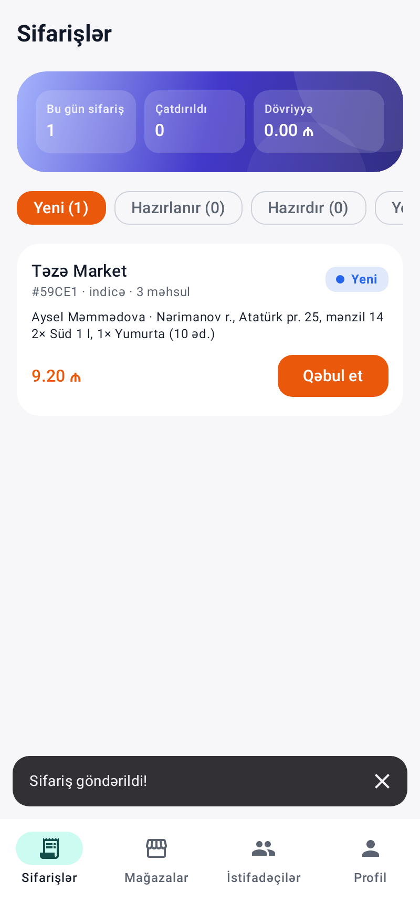
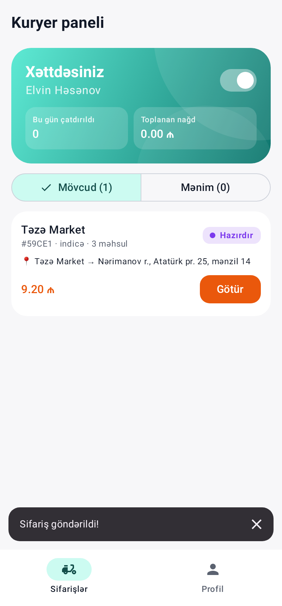
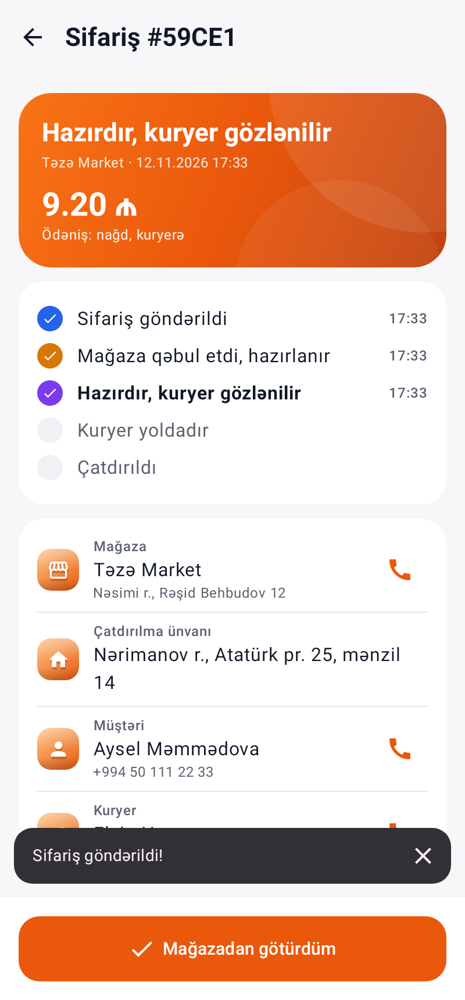
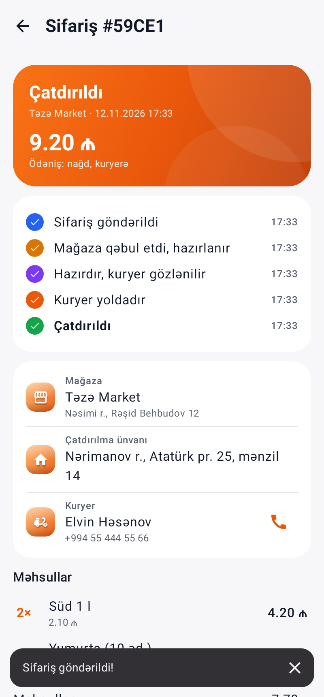

# Çatdır — mağazalardan çatdırılma platforması

İstənilən mağazanın (market, restoran, aptek, gül və s.) malını müştəriyə çatdırmaq üçün Android proqramı.
Bir proqramda üç rol var: **müştəri**, **kuryer**, **admin**. Hər kəs öz roluna görə ekran görür.
Kotlin + Jetpack Compose, server: **Firebase** (Auth + Firestore, real vaxt). Ödəniş: **nağd, kuryerə**. Ünvan: mətn.

**APK:** [`apk/Catdir-1.0.0-demo.apk`](apk/Catdir-1.0.0-demo.apk) — Firebase qoşulana qədər **demo rejimində** işləyir
(məlumatlar yalnız telefonda, proqram bağlananda silinir; rolları dəyişərək bütün axını bir telefonda sınaya bilərsiniz).

| Giriş | Mağazalar | Mağaza | Səbət | Sifariş |
|---|---|---|---|---|
|  |  |  |  |  |

| Admin: sifarişlər | Kuryer: mövcud sifarişlər | Kuryer: sifariş | Müştəri: çatdırıldı |
|---|---|---|---|
|  |  |  |  |

## Sifarişin yolu

```
Müştəri sifariş verir ─▶ Yeni ─admin "Qəbul et"─▶ Hazırlanır ─admin "Hazırdır"─▶ Hazırdır
                                                     │ kuryer "Götür" (hazırlanarkən də götürə bilər)
                                                     ▼
                          Çatdırıldı ◀─kuryer "Çatdırdım"─ Yolda ◀─kuryer "Mağazadan götürdüm"
Ləğv: müştəri — yalnız "Yeni" ikən; admin — kuryer yola çıxana qədər (səbəb seçilir).
```

## İmkanlar

**Müştəri**
- Mağazalar: axtarış, kateqoriya filtri, çatdırılma vaxtı/haqqı, minimum sifariş, açıq/bağlı.
- Mağaza səhifəsi: bölmələrə görə məhsullar, +/− ilə səbətə əlavə. Səbət yalnız bir mağazadan ola bilər (başqa mağaza seçiləndə soruşur).
- Səbət: miqdar, məhsullar + çatdırılma = cəmi, ünvan (profildən dolur), telefon, kuryerə qeyd, nağd ödəniş.
- Sifarişlərim: aktiv və keçmiş; sifariş səhifəsində addım-addım vəziyyət (vaxtları ilə), kuryerin adı və zəng düyməsi, "Yeni" ikən ləğv.

**Kuryer**
- Xəttə çıx / xəttdən çıx. Xəttdə olanda heç kimin götürmədiyi sifarişlər real vaxtda görünür.
- "Götür" — eyni sifarişi iki kuryer götürə bilməz (serverdə tranzaksiya ilə yoxlanılır).
- Mağaza ünvanı, müştəri ünvanı və telefonu (zəng), alınacaq nağd məbləğ; "Mağazadan götürdüm" → "Çatdırdım".
- Bu gün çatdırılan sifariş sayı və toplanan nağd.

**Admin**
- Sifarişlər lövhəsi: Yeni / Hazırlanır / Hazırdır / Yolda / Bitmiş; bu günün sifariş sayı və dövriyyəsi; "Qəbul et", "Hazırdır", ləğv.
- Mağazalar: əlavə et, redaktə et, sil; açıq/bağlı; çatdırılma haqqı, minimum sifariş, vaxt.
- Məhsullar: ad, qiymət, bölmə, təsvir, "satışdadır / yoxdur".
- İstifadəçilər: rol təyin etmə (müştəri / kuryer / admin), kuryerin xəttdə olub-olmaması.

**Təhlükəsizlik.** Telefona etibar edilmir: hər əməliyyat serverdə [`firebase/firestore.rules`](firebase/firestore.rules) ilə yoxlanılır —
qeydiyyatda hər kəs yalnız müştəri olur, rolu yalnız admin dəyişir, müştəri yalnız öz sifarişlərini görür,
kuryer yalnız boş və ya özünün sifarişini görür, statuslar yalnız düzgün ardıcıllıqla və düzgün rol tərəfindən dəyişir,
çatdırılma haqqı və cəm serverdə mağaza ilə yoxlanılır, sifariş silinə bilməz.
Pullar qəpiklə tam ədəd kimi saxlanılır (yuvarlaqlaşdırma xətası yoxdur).

## Firebase-i qoşmaq (bir dəfəlik)

1. <https://console.firebase.google.com> → **Add project** (məs. "Catdir"). Google Analytics lazım deyil.
2. **Add app → Android**. Package name: **`az.catdir.app`**. `google-services.json` faylını yükləyin.
3. **Build → Authentication → Get started → Sign-in method → Email/Password → Enable**.
4. **Build → Firestore Database → Create database** → yer: `eur3 (europe-west)` → **production mode**.
5. Firestore → **Rules** sekmesi: [`firebase/firestore.rules`](firebase/firestore.rules) faylının məzmununu yapışdırın → **Publish**.
6. `google-services.json` faylını `CatdirApp/app/` qovluğuna qoyun və APK-nı yenidən yığın (`./gradlew assembleRelease`) —
   proqram faylı görəndə avtomatik Firebase-ə qoşulur, demo rejim söner.
7. **İlk admin:** proqramda qeydiyyatdan keçin → Firebase konsolunda Firestore → `users` → öz sənədiniz →
   `role` sahəsini `CUSTOMER`-dən **`ADMIN`**-ə dəyişin. Sonrakı kuryer və adminləri proqramın "İstifadəçilər" bölməsindən təyin edirsiniz.
8. Admin kimi mağaza və məhsulları əlavə edin.

`google-services.json` şəxsi layihə faylıdır; `.gitignore`-a əlavə olunub, repoya düşmür.

## Məhdudiyyətlər (bu versiyada)

- **Bildirişlər:** yeni sifariş proqram açıq olanda real vaxtda görünür, amma proqram bağlı ikən push bildiriş gəlmir
  (bunun üçün Firebase Cloud Functions lazımdır, Blaze planı tələb edir).
- **Qiymət yoxlanışı:** proqram sifariş göndərməzdən əvvəl qiymətləri serverdən yenidən götürür və çatdırılma haqqı/cəm serverdə yoxlanılır,
  amma Firestore qaydaları hər məhsulun qiymətini ayrıca yoxlaya bilmir. Dəyişdirilmiş proqramla saxta qiymət göndərilsə, admin sifarişi
  qəbul etməzdən əvvəl məhsulları və cəmi görür. Tam zəmanət üçün sifarişi Cloud Function vasitəsilə yaratmaq lazımdır.
- Xəritə və kuryerin canlı yeri yoxdur (ünvan mətn kimi). Onlayn kart ödənişi yoxdur.

## Layihə strukturu

```
app/src/main/java/az/catdir/app/
├── model/      Models.kt, Money.kt (qəpik), OrderRules.kt (kim nə edə bilər — serverdəki qaydalarla eyni)
├── data/       Backend.kt (interfeys), FirebaseBackend.kt (Auth + Firestore), DemoBackend.kt (yerli demo)
├── ui/common/  Giriş, profil, sifariş səhifəsi (rola görə düymələr), ortaq komponentlər
├── ui/customer, ui/courier, ui/admin
├── AppViewModel.kt   səbət, əməliyyatlar, xəta mesajları
└── MainActivity.kt   rola görə ekran və alt menyu
firebase/       firestore.rules, firebase.json, rules.test.js (qaydaların testləri)
```

## Testlər

```bash
./gradlew testDebugUnitTest                      # məntiq + demo rejimdə tam UI axını
cd firebase && npm install && npm test           # Firestore qaydaları (emulyatorda, 11 test)
# Real FirebaseBackend kodu emulyatorlara qarşı (qeydiyyat → mağaza → sifariş → kuryer → çatdırıldı):
cd firebase && npx firebase emulators:exec --only auth,firestore --project catdir-test \
  "cd .. && FIREBASE_EMULATOR=1 ./gradlew testDebugUnitTest --tests '*FirebaseEmulatorTest*'"
```

- `LogicTest`: pul hesabı, status keçidləri, sifariş yoxlaması, demo backend-də tam axın, 5 kuryerin eyni anda götürməsi (yalnız biri uğurlu), qeydiyyat və rollar, səbət.
- `DemoFlowUiTest`: real ekranlarda müştəri sifariş verir → admin qəbul edir və hazır edir → kuryer götürür və çatdırır → müştəri "Çatdırıldı" görür.
- `rules.test.js`: saxta rol/status/qiymət, başqasının sifarişini oxumaq/götürmək, ardıcıllığı pozmaq, silmək — hamısı rədd edilir.
- `FirebaseEmulatorTest`: proqramın Firebase kodu emulyatorlarda bütün axını keçir; müştərinin saxta göndərdiyi qiymət serverdəki qiymətlə əvəz olunur.
