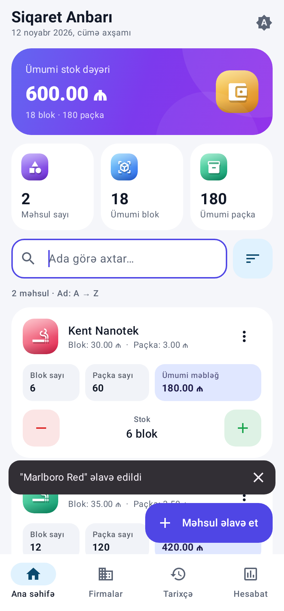
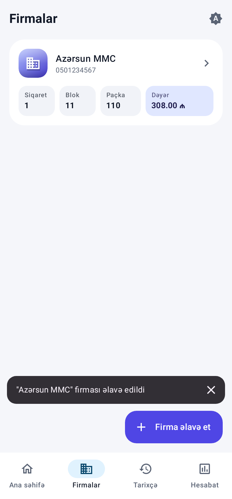
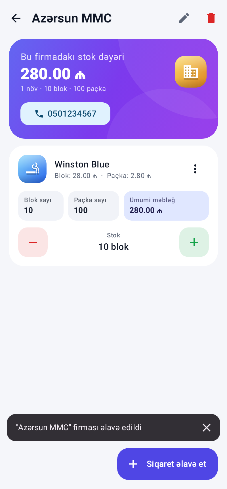
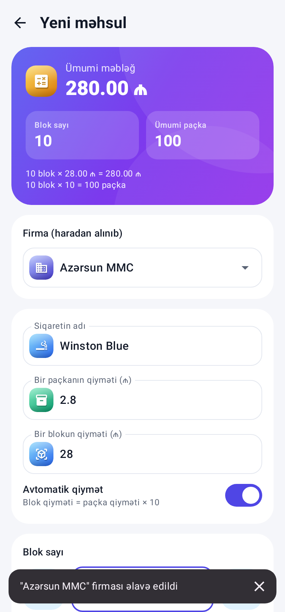
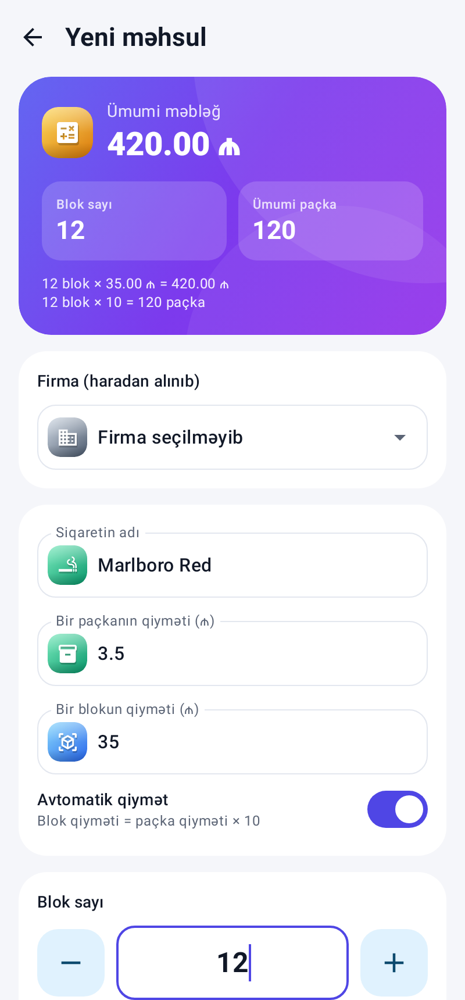
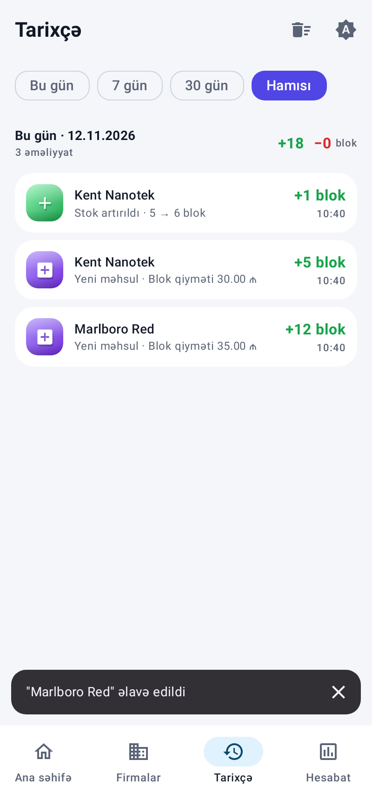
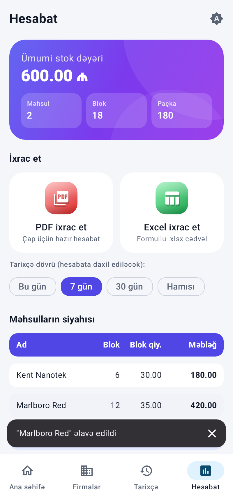
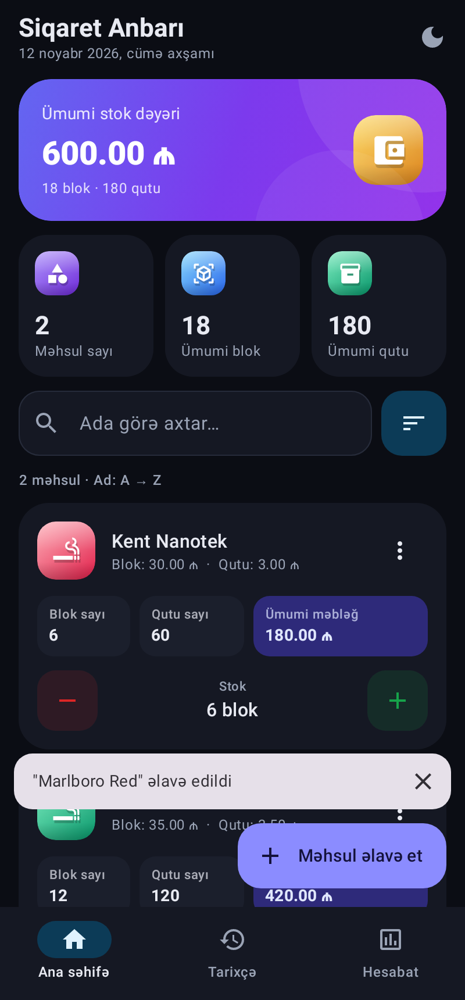

# Siqaret Anbarı — hesablama və anbar idarəetmə proqramı

Kotlin + Jetpack Compose + Room ilə yazılmış, tam offline işləyən Android tətbiqi.

**Hazır APK:** [`apk/SiqaretAnbar-1.1.1.apk`](apk/SiqaretAnbar-1.1.1.apk) (Android 7.0+). Telefona köçürün və quraşdırın ("Naməlum mənbələr"ə icazə verin). Köhnə versiya quraşdırılıbsa, üstündən yazın: məlumatlar saxlanılır.

| Ana səhifə | Firmalar | Firmanın siqaretləri | Firmaya siqaret əlavə et |
|---|---|---|---|
|  |  |  |  |

| Canlı hesablama | Tarixçə | Hesabat | Qaranlıq rejim |
|---|---|---|---|
|  |  |  |  |

## İmkanlar

**Firmalar (1.1.0):**
- Siqaret alınan firmaları əlavə edin: ad, telefon (istəyə görə), qeyd. Firmanı redaktə etmək və silmək olar.
- Firmanın səhifəsində həmin firmadan alınan siqaretlər, firmanın stok dəyəri, blok və paçka sayı göstərilir. Telefona basanda zəng ekranı açılır.
- Firmanın səhifəsində "Siqaret əlavə et" basılanda firma avtomatik seçilir. Məhsul formasında firmanı dəyişmək və ya oradan yeni firma yaratmaq olar.
- Eyni marka fərqli firmalardan alına bilər (eyni firmada isə ad təkrarlana bilməz).
- Ana səhifədə firmaya görə filtr var. Firma silinəndə onun siqaretləri silinmir, "Firmasız" bölməsinə keçir.
- Hesabatda "Firmalar üzrə" bölməsi var. PDF-də firma sütunu və firma xülasəsi, Excel-də "Firma" sütunu və "Firmalar" vərəqi əlavə olunub (SUMIF formulları ilə).

**Məhsul məlumatları:** ad, firma, bir paçkanın qiyməti, bir blokun qiyməti, blok sayı, ümumi paçka sayı, ümumi məbləğ.

**Hesablama (real vaxtda):**
- `Blok sayı × bir blokun qiyməti = ümumi məbləğ`
- `Blok sayı × 10 = ümumi paçka sayı`
- "Avtomatik qiymət" açıqdırsa: paçka qiymətini yazanda blok qiyməti (× 10) özü doldurulur və əksinə.
- Hesablamalar `BigDecimal` ilə aparılır, ona görə qəpik xətası olmur.
- Paçka qiyməti blokdan hesablananda yuvarlaqlaşdırılmır: 41.97 ₼ blok → 4.197 ₼ paçka, 10 blok = 419.70 ₼ (1.1.1-də düzəldildi; əvvəl bəzi hallarda 420.00 ₼ çıxırdı).
- "Avtomatik qiymət" yandırılanda digər qiymət son yazdığınız sahədən hesablanır, artıq yazılmış blok qiymətinə toxunulmur.

**Ana səhifə:** ümumi stok dəyəri, məhsul sayı, ümumi blok sayı, ümumi paçka sayı.

**Məhsul idarəetməsi:** əlavə et, redaktə et, sil (snackbar-dan "Geri qaytar" mümkündür), ada görə axtarış, ada/qiymətə/məbləğə/stoka görə sıralama. Hər kartda böyük **−/+** düymələri var, "Stok miqdarını dəyiş" pəncərəsi ilə istənilən miqdar artırılıb-azaldıla bilər. Eyni adlı məhsulun təkrar əlavə edilməsinin qarşısı alınır.

**Tarixçə:** hər əlavə, redaktə, silinmə, bərpa və stok dəyişikliyi qeyd olunur. Qeydlər günlərə görə qruplaşdırılır, hər gün üçün daxil olan və çıxan blok sayı göstərilir. Filtrlər: bu gün, 7 gün, 30 gün, hamısı.

**Hesabat və ixrac:**
- **PDF** (A4): xülasə, məhsul cədvəli və CƏMİ sətri, seçilmiş dövr üçün gündəlik tarixçə. Səhifələr avtomatik bölünür.
- **Excel (.xlsx)**: 4 vərəq (Məhsullar, Firmalar, Tarixçə, Gündəlik). Məbləğ və cəmlər Excel formulları ilə yazılır (`=ROUND(E5*D5,2)`, `=SUM(...)`), valyuta formatı ₼.
- Fayl istifadəçinin seçdiyi yerə saxlanılır, sonra "Paylaş" ilə WhatsApp, e-poçt və s. vasitəsilə göndərilə bilər.

**Dizayn:** Material 3, açıq, qaranlıq və sistem rejimi (seçim yadda qalır), qradiyent və parıltılı 3D ikonlar, yumru künclü kartlar, böyük düymələr, interfeys tam Azərbaycan dilindədir.

**Məlumatlar:** Room (SQLite) bazasında saxlanılır, internet tələb olunmur, tətbiq bağlananda məlumatlar itmir.

## Layihə strukturu

```
app/src/main/java/az/siqaret/anbar/
├── data/            Room: Product, Firm, HistoryEntry, DAO-lar, AppDatabase (+ v1→v2 miqrasiya), InventoryRepository
├── util/            InventoryCalc (hesablama qaydaları), Fmt, Report, PdfExporter, XlsxExporter
├── ui/theme/        Rənglər (light/dark), tipoqrafiya, qradiyentlər
├── ui/components/   Icon3D, StatCard, GradientCard, ThemeMenuButton ...
├── ui/screens/      HomeScreen, FirmsScreen (+ firma səhifəsi), ProductEditScreen, HistoryScreen, ReportScreen
├── InventoryViewModel.kt
└── MainActivity.kt  Naviqasiya + alt menyu
```

## Yığma (build)

Android Studio (Ladybug və ya daha yeni) ilə `SiqaretAnbar` qovluğunu açın və ya terminaldan:

```bash
cd SiqaretAnbar
./gradlew assembleRelease     # app/build/outputs/apk/release/app-release.apk
./gradlew testDebugUnitTest   # hesablama, Excel və tam UI axını testləri
```

Release APK hazırda **debug açarı** ilə imzalanır ki, birbaşa quraşdırıla bilsin. Google Play-ə yükləmək üçün `app/build.gradle.kts` faylında öz release açarınızı (keystore) təyin edin.

## Testlər

- `CalcAndExportTest`: hesablama düsturları, ədəd daxiletməsi və formatlama, gündəlik xülasə, .xlsx faylının düzgünlüyü.
- `MigrationTest`: 1.0.0 versiyasının bazası yeni versiyaya keçəndə məhsulların və tarixçənin itmədiyini yoxlayır.
- `AppFlowTest.firmFlow`: firma yaradır, firmaya siqaret əlavə edir (firma avtomatik seçilir), firmanın səhifəsindən +1 blok edir, firmalar siyahısını və ana səhifədəki firma filtrini yoxlayır.
- `AppFlowTest.fullFlow` (Robolectric): real `MainActivity` + Room bazası işə salınır. Test iki məhsul əlavə edir, canlı hesablamanı yoxlayır, +1 blok düyməsinə basır, təkrar ad xətasını, axtarışı, tarixçəni, hesabatı və qaranlıq rejimi yoxlayır.
